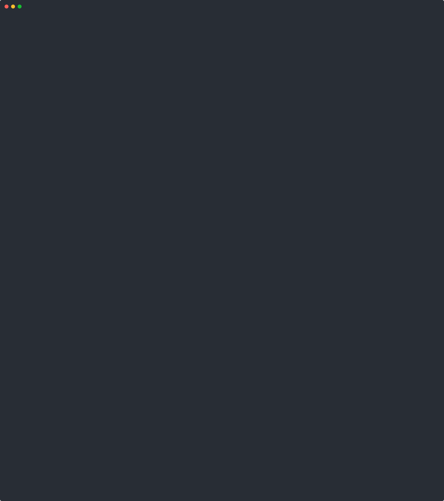
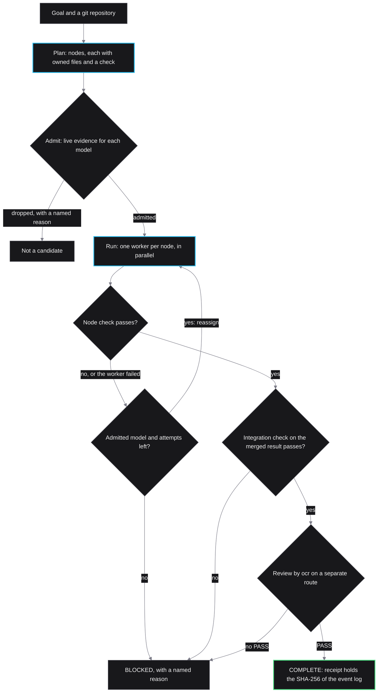

<div align="center">

# Verdict

**A control plane for coding agents that shows its work.** <!-- claim:C-001 -->

Verdict decides which model may run each piece of a coding task, checks the work, has a different model review it, and writes a receipt you can verify.<br>
Model admission, bounded recovery, a separate review route and receipts you can verify. <!-- claim:C-002 -->

[](https://github.com/mrnicholasbcarter-code/verdict-core/actions/workflows/ci.yml)
[](https://github.com/mrnicholasbcarter-code/verdict-core/actions/workflows/security.yml)
[](.github/workflows/ci.yml)
[](pyproject.toml)
[](pyproject.toml)
[](LICENSE)

<p align="center"><picture><source media="(prefers-reduced-motion: reduce)" srcset="docs/assets/live-cockpit-poster.svg"></picture></p>

*Replay of one live `verdict orchestrate` run on the operator's gateway (2026-11-19, main `35c110c1`, FREE capacity only), not a fixture and not a benchmark. Idle time is capped: gaps between events over 1.5 s are shortened. [asciicast](docs/assets/live-cockpit.cast) | [evidence record](docs/proof/live-cockpit-20261119T130739Z/README.md)*

[Where it stands](#where-it-stands) | [What changed](#what-changed-since-100) | [Quick start](#quick-start-no-api-keys) | [How a run works](#how-a-run-works) | [Limits](#limits) | [Docs](#documentation)

</div>

<table>
<tr>
<td width="33%" valign="top"><h3>Admit</h3>Models are checked against live account, health and quota evidence before they are used. Every refusal has a named reason, and a model with no evidence stays <code>unknown</code>.</td>
<td width="33%" valign="top"><h3>Recover</h3>A rate limit, timeout or failed check moves the work to another admitted model, within a fixed number of tries. When they are spent the run ends <code>BLOCKED</code>. It does not hang.</td>
<td width="33%" valign="top"><h3>Prove</h3>A reviewer on a route that did not write the code must approve it. The receipt holds a SHA-256 digest of the event log, and <code>verdict run-receipt</code> detects any change.</td>
</tr>
</table>

---

## Where it stands

| Works today | Early | Not yet |
|---|---|---|
| Admission from live evidence, with a named reason for every refusal | Verdict building Verdict: one story, six runs, five of them `BLOCKED` | A published 1.0.0: the certification rehearsal has not passed |
| Bounded recovery and reassignment across admitted models | Free capacity as worker supply: it needs fresh admission evidence each time | Any cost or token saving claim |
| Review on a separate route; a skipped review is an error | Context packing: one dated live observation, n=1 | Signed or externally anchored receipts |
| Receipts that detect a changed event log | | OpenCode, Claude Code or Codex as the default worker |

Every row is expanded, with its evidence, under [Limits](#limits) and [Roadmap](#roadmap).

## What changed since 1.0.0

Merged between 2026-11-19 and 2026-11-24. Each line links to the pull request that carries its tests.

| Area | Change |
|---|---|
| **Planning** | Planners are chosen from the frontier band of live ratings, not a fixed list ([ADR-051](docs/adr/ADR-051-planner-frontier-from-ratings.md), [#1266](https://github.com/mrnicholasbcarter-code/verdict-core/pull/1266)). When only one model family can plan, the run proceeds and records that ([#1305](https://github.com/mrnicholasbcarter-code/verdict-core/pull/1305)). The planner always gets the repository's structure map ([#1296](https://github.com/mrnicholasbcarter-code/verdict-core/pull/1296)). |
| **Admission and cost class** | One capacity classifier, and a route's name never decides its cost class ([#1185](https://github.com/mrnicholasbcarter-code/verdict-core/pull/1185)). Billing facts come from the gateway's connections, not from a guess about login type ([#1268](https://github.com/mrnicholasbcarter-code/verdict-core/pull/1268)). The cheapest sufficient route is tried first ([#1194](https://github.com/mrnicholasbcarter-code/verdict-core/pull/1194)), and a node escalates to a stronger route after two judged failures ([#1182](https://github.com/mrnicholasbcarter-code/verdict-core/pull/1182)). |
| **Finding free capacity** | A discovery funnel with several sources, a proof registry and a scheduled refresh for free routes ([#1176](https://github.com/mrnicholasbcarter-code/verdict-core/pull/1176), [#1184](https://github.com/mrnicholasbcarter-code/verdict-core/pull/1184), [#1239](https://github.com/mrnicholasbcarter-code/verdict-core/pull/1239)). `verdict identify --screen` reaches subscription frontier routes and skips routes that are cooling down or are not chat models ([#1303](https://github.com/mrnicholasbcarter-code/verdict-core/pull/1303), [#1320](https://github.com/mrnicholasbcarter-code/verdict-core/pull/1320)). |
| **Measuring the result** | `verdict metrics --daily` reports accepted work per paid model share. A first attempt counts as a pass only when the node ended validated ([#1298](https://github.com/mrnicholasbcarter-code/verdict-core/pull/1298), [#1321](https://github.com/mrnicholasbcarter-code/verdict-core/pull/1321)). It is a report, not a savings claim. |
| **Reading a run** | Read-only endpoints list runs, page through a run's events and return its receipt with a live digest check ([#1179](https://github.com/mrnicholasbcarter-code/verdict-core/pull/1179)). Receipts record the size of each context pack ([#1183](https://github.com/mrnicholasbcarter-code/verdict-core/pull/1183)). |
| **Failing closed** | A metadata refresh that skips a ratings source keeps that source's stored values and says so ([#1310](https://github.com/mrnicholasbcarter-code/verdict-core/pull/1310)). A blocked context-lift bench exits non-zero ([#1302](https://github.com/mrnicholasbcarter-code/verdict-core/pull/1302)). Environment failures are classified apart from failed verification ([#1203](https://github.com/mrnicholasbcarter-code/verdict-core/pull/1203)). |

The full list is in the [changelog](CHANGELOG.md).

## The problem

A coding agent can reach many models through one gateway. Some are out of quota. Some are rate-limited. Some cannot call tools. The model list does not tell you which. When the run ends you are told it passed. You are not told which model did the work, which models were refused and why, or whether anyone other than the author looked at the result.

Give Verdict a goal and a git repository. It plans the work, admits models from live evidence, runs the work in parallel, reassigns a node when a model fails, asks a reviewer on a separate route to approve the result, and writes a receipt you can check afterward. A model that fails
an admission check cannot be ranked back in.

Verdict does not run models itself. OmniRoute, a local OpenAI-compatible gateway, lists the models and carries the calls. `ocr` (open-code-review) does the review.

## Quick start (no API keys)

The fixture makes one deterministic routing decision. It needs no API key, no gateway and no model call:

```bash
git clone https://github.com/mrnicholasbcarter-code/verdict-core && cd verdict-core
python3 -m venv .venv && source .venv/bin/activate
pip install -e .

verdict quickstart --non-interactive --dry-run
```

```text
Verdict credential-free quickstart
===================================
Task: Add structured output to the invoice parser
Required capabilities: structured_output, tools
Selected route: demo/frontier-tools
Excluded candidates: 3
Receipt: fixture:issue-35 (deterministic_fixture)
Status: PASS
- demo/no-tools: missing capability: tools
- demo/quota-empty: quota exhausted
- demo/unverified: health unknown
```

Three candidates were refused, and each refusal has a named reason. Source: [`verdict/flagship_demo.py`](verdict/flagship_demo.py). Test: [`tests/test_flagship_demo.py`](tests/test_flagship_demo.py) asserts this block byte for byte. <!-- claim:C-015 -->

### Run the whole loop offline

```bash
verdict demo
```

```text
18    failure         node-1    category=rate_limited
...
58    review                    attempt 1  reviewer=gamma/gemini-c  PASS
...
60    run_finished              outcome=COMPLETE

OFFLINE SCENARIO: scripted workers (1.5 s each), injected faults
```

`verdict demo` is an **offline self-test**: scripted workers, fixture routes and injected faults, with no model calls. It runs the real orchestration pipeline (planner, admission, DAG runtime, failure handling, integration barrier, review-route policy, receipt writer) against fixture data. It shows the mechanics. It is not evidence of live behaviour. The full trace and the offline recordings are in the [offline demo guide](docs/guides/offline-demo.md). <!-- claim:C-029 -->

## How a run works

1. **Plan.** A planner model splits the goal into a small graph of work items, called nodes. Each node owns its files and has a command that checks the work.
2. **Admit.** Verdict builds one list of models that may be used now, from live gateway evidence: inventory, accounts, health, cooldowns and quota. Every dropped model gets a named reason. A model with no runtime evidence stays `unknown`. It is never counted as healthy.
3. **Run.** Each node runs as its own worker, in parallel where the graph allows. By default workers use the built-in `direct-gateway` executor: each worker request goes straight to the gateway, so no agent has to be installed.
4. **Recover.** A quota limit, rate limit, timeout or empty answer cools down the route or its provider, and the node goes to another admitted model. When none is left, or the attempt budget is spent, the node stops with a named `FAIL_CLOSED` and the run ends `BLOCKED`.
5. **Check and review.** Each node must pass its own check. The merged result must pass an integration check. Then `ocr` reviews the diff on a route that no final implementer used.
6. **Receipt.** The run writes a receipt that holds a SHA-256 digest of its event log.



The eligibility ladder, the recovery rules, the three engineering diagrams and the source file behind each step are in [docs/HOW_IT_WORKS.md](docs/HOW_IT_WORKS.md).

## What you get

| | |
|---|---|
| **Models are checked before they are trusted** | Verdict looks at live account, health and quota evidence before it uses a model, and records why it dropped any other. <!-- claim:C-003 --> |
| **Free and already-paid capacity first** | Eligible free and already-paid capacity is tried before pay-per-call routes. This is a selection policy, not a savings claim. The [retained live run](docs/proof/dogfood-bod-225-live-2026-09-29/README.md) used subscription workers, not free workers; free capacity still needs fresh admission evidence. <!-- claim:C-004 --><!-- claim:C-016 --><!-- claim:C-017 --> |
| **Recovery with a limit** | A quota limit, rate limit, timeout or failed verification can retry the same work, sometimes on another admitted model, within a bounded number of tries. When the tries are spent or no admitted model is left, the run ends `BLOCKED`. It does not hang. <!-- claim:C-005 --> |
| **A separate review route** | A reviewer on a route that did not implement the work must approve the result. Another model family is preferred; when none has capacity, review falls back to route-level independence. A skipped or empty review is an error, not a pass. <!-- claim:C-006 --> |
| **A receipt you can verify** | A completed run's receipt stores a digest of its event log. `verdict run-receipt` checks that log against the receipt and flags any change. <!-- claim:C-007 --> |
| **A live view** | `verdict watch` shows a run while it happens, and replays a finished one. |

## What a receipt proves, and what it does not

| A verified receipt proves | It does not prove |
|---|---|
| The event log is byte-for-byte the one the receipt was written from (SHA-256 digest). | That nobody replaced both the log and the receipt. Neither is signed or externally anchored. |
| Every field of the receipt can be rebuilt from that log: nodes, attempts, routes, failures, reassignments, review status. | That the model output or the code is correct. Each node's own check and the review decide that. |
| A reviewer on a route that did not implement the final work recorded PASS. | That the review was thorough. Raw `ocr` output must show non-skipped coverage to count as semantic review. |
| Which routes were tried, refused or cooled down, and why. | The capacity class or cost a provider actually billed. |

## Verify a receipt yourself

From your clone, check a tracked live-run receipt. Then check a copy with one byte added to its event log:

```bash
verdict run-receipt docs/proof/dogfood-bod-225-live-2026-09-29

copy="$(mktemp -d)/tampered"
cp -r docs/proof/dogfood-bod-225-live-2026-09-29 "$copy" && printf ' ' >> "$copy/events.jsonl"
verdict run-receipt "$copy"
```

```text
COMPLETE: all implement/integrate nodes validated, barrier ok, review PASS
integrity: OK (events digest verified)
...
INTEGRITY FAILED: events_digest mismatch: events.jsonl changed after receipt was written
recorded (unverified): COMPLETE: all implement/integrate nodes validated, barrier ok, review PASS
...
```

The first command exits 0. The second exits 1, names the digest mismatch first, and labels the stored outcome as recorded but unverified.

### Proof from a live run

**A bundle you can verify.** [`docs/proof/dogfood-bod-225-live-2026-09-29/`](docs/proof/dogfood-bod-225-live-2026-09-29) holds a live `verdict orchestrate` run for a real story (BOD-225), with real providers reached through OmniRoute. It is not a fixture. It records one injected fault and two real worker faults, a controller restart and resume, and a reviewer PASS on a route no final worker used. It is a single run. The raw `ocr` output was not retained, so the review itself cannot be re-audited from the bundle. Its [README](docs/proof/dogfood-bod-225-live-2026-09-29/README.md) says what it proves and what it does not.

**The recording at the top.** One `verdict orchestrate` run from main `35c110c1` on 2026-11-19, on free routes only: a real HTTP 429 and a failed test on `cerebras/gpt-oss-120b`, both nodes reassigned to `nvidia/google/gemma-4-31b-it`, review PASS by `ocr` on a route from another model family, receipt integrity OK. Its [evidence record](docs/proof/live-cockpit-20261119T130739Z/README.md) quotes the run's digests and `verdict run-receipt` output. It is an evidence record, not a verifiable bundle: the raw event log is kept privately because it holds host paths. An earlier one-node run has its own [evidence record](docs/proof/live-run-20261119T000727Z/README.md).

**Verdict building Verdict.** Verdict has built one story of its own: BOD-305, merged as [PR #1115](https://github.com/mrnicholasbcarter-code/verdict-core/pull/1115). It took six runs and five of them ended `BLOCKED`. This is not routine yet.

## Install

Version 1.0.0 is on PyPI. <!-- claim:C-025 --> It is not certified: the attested certification rehearsal has not passed yet (see #1168 and #1169).

```bash
pip install verdict-core
```

`verdict demo` and `verdict quickstart` ship in the package. <!-- claim:C-009 --> To work from source, clone the repository and run `pip install -e .`.

The rest of this README describes 1.0.0.

Python 3.10, 3.11, 3.12 and 3.13, tested in CI on Linux (Ubuntu). macOS and Windows are not tested in CI.

## A live run

A live run needs four things: an OmniRoute gateway at `http://localhost:20128` with at least one provider account, its key exported as `VERDICT_OMNIROUTE_API_KEY`, `ocr` on your PATH, and a git repository to change.

```bash
verdict doctor                                  # health check, with a repair command for each failure
verdict orchestrate "your goal, in a sentence" --repo .
verdict watch <run-id>                          # live view of the run
verdict run-receipt <run-id>                    # show and verify its receipt
```

`verdict serve` is the HTTP service (install it with `pip install -e '.[server]'`). `POST /v1/route` returns a route decision for a request that carries an `execution_path_request`. `POST /v1/chat/completions` routes a call and relays it upstream. It needs `LLMGATE_AUTH_TOKEN` and `VERDICT_RECEIPTS_DB` before it starts; `verdict setup --apply --allow host.serve` sets both. See [first run](docs/CONFIGURATION.md#first-run).

Claude Code, Codex, Cursor, Cline and OpenCode can be pointed at that relay as their model endpoint: `verdict harness <tool> enable`. That makes the tool a client of Verdict. It does not make it a worker: `verdict orchestrate` cannot run a worker on any of them. See the [harness guide](docs/guides/harnesses.md).

## Architecture

Verdict is the control plane. Other tools do the execution, and Verdict only calls them.

| Part | What it does |
|---|---|
| **Verdict** | Plans, admits and selects models, recovers from failures, verifies, writes receipts. Never runs a model itself. |
| **OmniRoute** | The gateway: lists the models (`/v1/models`) and carries every model call (`/v1/chat/completions`). |
| **Worker executor** | Runs one node. `direct-gateway` by default. It never selects a model: Verdict passes it the exact admitted route. |
| **`ocr`** | The reviewer CLI (open-code-review). Runs on a route no implementer used. |

Component map and data flow: [`docs/architecture.md`](docs/architecture.md). The design decision behind the loop: [ADR-036](docs/adr/ADR-036-goal-to-receipt-orchestration.md).

## Limits

- **1.0.0 is not released.** The release workflow requires a CERTIFIED evidence bundle (repository variable `VERDICT_REQUIRE_CERTIFIED_BUNDLE` is `true`). None exists, because the certification rehearsal does not pass yet. Until one exists the workflow refuses to publish.
- **No cost saving is claimed yet.** No token saving is claimed either. The 2026-09-28 live cost check chose the same model in both arms, so it measured no routing saving. One paired usage run on 2026-11-19 did not support a claim: the Verdict arm completed fewer tasks than the baseline, so the bench refused it. Its evidence is not published. See [`docs/benchmarks/README.md`](docs/benchmarks/README.md). <!-- claim:C-018 -->
- **Context packing: one dated live observation, not offline proof.** One recorded paired run, n=1, on a live gateway. See [`docs/benchmarks/context-lift.md`](docs/benchmarks/context-lift.md). A blocked or skipped live run makes no lift claim.
- **Self-hosting is early.** One story built by Verdict itself, in six runs, five of them `BLOCKED`.
- **Live orchestration requires a gateway.** OmniRoute must be running at `http://localhost:20128`. The credential-free quickstart and benchmark paths need no gateway. <!-- claim:C-019 -->
- **Worker model availability is external.** Verdict combines gateway inventory and account evidence with its own runtime health and admission evidence before selection. Quota, rate limits, and provider outages are not under Verdict's control. It recovers from them, but cannot prevent them. <!-- claim:C-020 -->
- **Workers run on `direct-gateway` by default.** There is no worker executor for OpenCode, Claude Code or Codex.
- **Independent review requires `ocr` on PATH.** `open-code-review` is a separate binary. `--no-review` skips it and ends the run `BLOCKED`. <!-- claim:C-021 -->
- **Receipt integrity covers event logs, not LLM or OCR output.** Verification detects event-log changes against the retained receipt. Recorded reviewer PASS alone can lack semantic coverage. Neither the receipt nor the log is signed or externally anchored against replacing both files. <!-- claim:C-022 -->
- **No static fallback chains (retries stay inside the admitted set); OpenTelemetry is optional (`verdict-core[tracing]`).** See [How Verdict differs](docs/guides/comparison.md#how-verdict-differs). <!-- claim:C-023 -->
- **Version 1.0.0, active development.** Contracts, schemas, and receipt formats are versioned. Breaking changes require an ADR. <!-- claim:C-024 -->

## Documentation

| Topic | Location |
|---|---|
| How it works, in full: the loop, the ladder, three diagrams, feature tables, decision signals | [`docs/HOW_IT_WORKS.md`](docs/HOW_IT_WORKS.md) |
| Getting started | [`docs/GETTING_STARTED.md`](docs/GETTING_STARTED.md) |
| A live orchestration run, step by step | [`docs/guides/orchestration-golden-path.md`](docs/guides/orchestration-golden-path.md) |
| Offline demo, its trace and recordings | [`docs/guides/offline-demo.md`](docs/guides/offline-demo.md) |
| Every command and flag | [`docs/CLI_REFERENCE.md`](docs/CLI_REFERENCE.md) |
| Configuration, entry points, live gateway checks | [`docs/CONFIGURATION.md`](docs/CONFIGURATION.md) |
| API keys and optional dependencies | [`docs/credentials.md`](docs/credentials.md) |
| Coding-agent harnesses: clients of the relay, and the optional worker harness | [`docs/guides/harnesses.md`](docs/guides/harnesses.md) |
| How Verdict differs; LiteLLM, OpenRouter, Portkey | [`docs/guides/comparison.md`](docs/guides/comparison.md) |
| Architecture and decisions | [`docs/architecture.md`](docs/architecture.md), [ADR index](docs/adr/README.md) |
| Evidence: index, benchmarks, claim ledger | [`docs/proof/EVIDENCE_INDEX.md`](docs/proof/EVIDENCE_INDEX.md), [`docs/benchmarks/README.md`](docs/benchmarks/README.md), [`docs/CLAIMS.md`](docs/CLAIMS.md) |
| Unknown is not healthy: fail-closed drops | [`docs/guides/unknown-not-healthy.md`](docs/guides/unknown-not-healthy.md) |
| Receipt threat model | [`docs/THREAT_MODEL_RECEIPTS.md`](docs/THREAT_MODEL_RECEIPTS.md) |
| User journey and maturity of each step | [`docs/USER_JOURNEY.md`](docs/USER_JOURNEY.md) |
| Changelog and upgrade notes | [`CHANGELOG.md`](CHANGELOG.md) |

## Roadmap

None of this is done. It is listed so nothing above is read as covering it.

- **Publish 1.0.0.** Waits on a passing certification rehearsal.
- **A worker executor for OpenCode.** Planned, not started.
- **Cross-provider fencing on the first worker failure.** Today a failure cools down only the failed route or its own provider.
- **A single retry authority.** Node recovery, the relay and the reviewer each keep their own bounded retry loop today.
- **Subscription headroom-aware selection.** Admission drops exhausted subscription routes. Selection does not yet rank eligible routes by the headroom left.
- **Automatic gateway restart and upgrade.** Verdict can start a configured local gateway when you opt in. It does not restart an unhealthy one or upgrade OmniRoute.

## Contributing

Start with [`CONTRIBUTING.md`](CONTRIBUTING.md) and [`AGENTS.md`](AGENTS.md). Security reports: [`SECURITY.md`](SECURITY.md).

## License

MIT. See [`LICENSE`](LICENSE).
