```mermaid
%% eligibility-ladder.mmd -- DISCOVERED -> ENTITLED -> HEALTHY -> AVAILABLE -> TASK_ELIGIBLE -> SELECTED
%% Source (verified against code at this commit):
%%   verdict/orchestration/contracts.py (EligibilityStage, RouteVerdict, TaskRequirements)
%%   verdict/orchestration/eligibility.py (EligibilityLadder._assess, _task_gate, select, _rank_key, cooldown_seconds_for)
%% Verdict visual theme. Hex from verdict/design.py PALETTE:
%% background #101014  surface #18181b  text #f4f4f5  secondary #a1a1aa  muted #92929e
%% purple #a78bfa  cyan #22b8eb  success #4ade80  amber #f5b00b  red #f87171  border #52525b
%% Edges/lines use #7c7c88 (>=3:1 on #ffffff and #0d1117; measured 4.12:1 / 4.59:1).
%% fontFamily omitted: Mermaid sanitizeDirective drops hyphenated themeVariable values.
%%{init: {'theme':'base','themeVariables':{'darkMode':true,'background':'#101014','fontSize':'15px','primaryColor':'#18181b','primaryTextColor':'#f4f4f5','primaryBorderColor':'#52525b','secondaryColor':'#18181b','secondaryTextColor':'#f4f4f5','secondaryBorderColor':'#52525b','tertiaryColor':'#101014','tertiaryTextColor':'#f4f4f5','tertiaryBorderColor':'#52525b','lineColor':'#7c7c88','textColor':'#f4f4f5','mainBkg':'#18181b','nodeTextColor':'#f4f4f5','nodeBorder':'#52525b','clusterBkg':'#101014','clusterBorder':'#52525b','titleColor':'#f4f4f5','edgeLabelBackground':'#18181b','noteBkgColor':'#18181b','noteTextColor':'#f4f4f5','noteBorderColor':'#52525b','actorBkg':'#18181b','actorBorder':'#a78bfa','actorTextColor':'#f4f4f5','actorLineColor':'#7c7c88','signalColor':'#7c7c88','signalTextColor':'#f4f4f5','labelBoxBkgColor':'#18181b','labelTextColor':'#f4f4f5','loopTextColor':'#f4f4f5','activationBkgColor':'#101014','activationBorderColor':'#22b8eb','sequenceNumberColor':'#101014'}}}%%
stateDiagram-v2
    direction TB
    [*] --> DISCOVERED

    DISCOVERED : present in the inventory rows passed to EligibilityLadder
    ENTITLED : an active provider connection backs the route (conn.isActive)
    HEALTHY : recent probe recorded healthy, or none yet recorded (lazy)
    AVAILABLE : no active route/provider cooldown, no rate-limit window
    TASK_ELIGIBLE : capabilities, context, exclusions, frontier policy fit
    SELECTED : ranked first among selectable candidates and probe-confirmed healthy

    state NotDiscovered {
        [*] --> OpaqueSkipped
        OpaqueSkipped : route id starts with auto/, combo/, router/, virtual/, or owned_by == "combo" -- skipped before assessment, never emitted
    }

    DISCOVERED --> NotDiscovered : opaque prefix or combo owner -> never DISCOVERED, no verdict at all
    DISCOVERED --> ENTITLED : _connection_for(provider) returns a connection and conn.isActive
    DISCOVERED --> FailedEntitled : conn is None or not isActive -> reason=no_active_account
    DISCOVERED --> FailedEntitled2 : harness_visible(route_id) is False -> reason=not_harness_visible (or harness_inventory_unavailable if the harness gate itself is unavailable)

    ENTITLED --> HEALTHY : _health_status returns anything other than unhealthy (healthy, unprobed, or stale all continue)
    ENTITLED --> FailedHealthy : _health_status == unhealthy -> failed_stage=HEALTHY, reason=health_category, cooldown_until set if a route cooldown is active

    HEALTHY --> AVAILABLE : no active cooldown for route:ROUTE_ID or provider:PROVIDER, and no rate_limited_until window covers now
    HEALTHY --> FailedAvailable : active cooldown route:ROUTE_ID -> reason=cooldown:route
    HEALTHY --> FailedAvailable2 : active cooldown provider:PROVIDER -> reason=cooldown:provider
    HEALTHY --> FailedAvailable3 : _rate_limited_until(conn) covers now -> reason=provider_rate_limited

    AVAILABLE --> TASK_ELIGIBLE : _task_gate returns empty string
    AVAILABLE --> FailedTask : missing capability (required_capabilities vs row.capabilities, "tools" maps to tool_calling) -> reason=missing_capability:CAP_NAME
    AVAILABLE --> FailedTask2 : max_input_tokens/context_length below min_context_tokens -> reason=insufficient_context
    AVAILABLE --> FailedTask3 : route_id in exclude_routes, or route_family(route_id) in exclude_families -> reason=excluded_route / excluded_family
    AVAILABLE --> FailedTask4 : non-frontier-worthy work excludes tier-0 routes only when capacity is not subscription/free -> reason=frontier_restricted
    AVAILABLE --> FailedTask5 : route id is an effort-suffixed duplicate (-low/-medium/-high/-xhigh/-max/-ultra) of a base row that also exists -> reason=effort_duplicate

    TASK_ELIGIBLE --> SELECTED : select() probes candidates in rank order (round-robin across providers within a capacity tier), first one that is healthy or probes healthy is chosen -> reason=selected
    TASK_ELIGIBLE --> FailedSelected : load(route_id) >= max_per_route (2) before probing -> failed_stage=SELECTED, reason=at_capacity
    TASK_ELIGIBLE --> ProbeBudgetExhausted : select() has already used max_probes_per_select (8) probes this call -> reason=probe_budget_exhausted (route stays TASK_ELIGIBLE, just not probed this call)

    SELECTED --> [*]
    FailedEntitled --> [*]
    FailedEntitled2 --> [*]
    FailedHealthy --> [*]
    FailedAvailable --> [*]
    FailedAvailable2 --> [*]
    FailedAvailable3 --> [*]
    FailedTask --> [*]
    FailedTask2 --> [*]
    FailedTask3 --> [*]
    FailedTask4 --> [*]
    FailedTask5 --> [*]
    FailedSelected --> [*]
    ProbeBudgetExhausted --> [*]
%% evidence: verdict/orchestration/contracts.py:296 EligibilityStage enum (DISCOVERED..SELECTED, each with a docstring comment)
%% evidence: verdict/orchestration/contracts.py:335 RouteVerdict (route_id, provider, reached, failed_stage, reason, capacity_class, plan_label, cooldown_until, rank)
%% evidence: verdict/orchestration/contracts.py:410 TaskRequirements (required_capabilities, min_context_tokens, exclude_routes, exclude_families, frontier_worthy)
%% evidence: verdict/orchestration/eligibility.py:38 _OPAQUE_PREFIXES = ("auto/", "combo/", "router/", "virtual/")
%% evidence: verdict/orchestration/eligibility.py:753-757 opaque prefix / owned_by == "combo" skipped before assessment, "opaque routers are never DISCOVERED"
%% evidence: verdict/orchestration/eligibility.py:494-495 conn is None or not isActive -> failed_stage=ENTITLED, reason=no_active_account
%% evidence: verdict/orchestration/eligibility.py:497-500 harness_visible check -> not_harness_visible / harness_inventory_unavailable
%% evidence: verdict/orchestration/eligibility.py:399 _health_status(route_id, now) -> healthy|unhealthy|unprobed|stale (TTL-gated)
%% evidence: verdict/orchestration/eligibility.py:504-505 health == "unhealthy" -> failed_stage=HEALTHY
%% evidence: verdict/orchestration/eligibility.py:513-519 cooldown:route / cooldown:provider -> failed_stage=AVAILABLE
%% evidence: verdict/orchestration/eligibility.py:523-527 provider_rate_limited -> failed_stage=AVAILABLE
%% evidence: verdict/orchestration/eligibility.py:559,572,575,577,579,597,600 _task_gate: missing_capability, insufficient_context, excluded_route, excluded_family, frontier_restricted, effort_duplicate
%% evidence: verdict/orchestration/eligibility.py:763-764 load(route_id) >= max_per_route (2) -> failed_stage=SELECTED, reason=at_capacity
%% evidence: verdict/orchestration/eligibility.py:706 _rank_key (capacity order, preferred provider, load, -fit, route_id)
%% evidence: verdict/orchestration/eligibility.py:229,244,800,820 select(): max_probes_per_select=8, probe_order round-robin, probe_budget_exhausted
%% evidence: verdict/orchestration/eligibility.py:855-861 chosen route emitted with reached=SELECTED, reason="selected"
%% evidence: verdict/orchestration/eligibility.py:60,127 cooldown_seconds_for / _CATEGORY_COOLDOWN_SECONDS per failure category

classDef active fill:#18181b,stroke:#22b8eb,color:#f4f4f5,stroke-width:2px
classDef selected fill:#18181b,stroke:#a78bfa,color:#f4f4f5,stroke-width:2px
classDef cooldown fill:#18181b,stroke:#f5b00b,color:#f4f4f5,stroke-width:2px
classDef failed fill:#18181b,stroke:#f87171,color:#f4f4f5,stroke-width:2px
classDef validated fill:#18181b,stroke:#4ade80,color:#f4f4f5,stroke-width:2px
classDef muted fill:#18181b,stroke:#52525b,color:#a1a1aa,stroke-width:1px
class DISCOVERED,ENTITLED,HEALTHY,AVAILABLE,TASK_ELIGIBLE active
class SELECTED selected
class FailedAvailable,FailedAvailable2,FailedAvailable3 cooldown
class FailedEntitled,FailedEntitled2,FailedHealthy,FailedTask,FailedTask2,FailedTask3,FailedTask4,FailedTask5,FailedSelected failed
class ProbeBudgetExhausted muted
class OpaqueSkipped muted

```

# How Verdict works

The [README](../README.md) gives the short version: what Verdict is, a first run, and what a
receipt proves. This page holds the engineering detail that used to sit in the README: the loop
step by step, the source file behind each step, three diagrams, the feature tables, decision
signals and the release gate.

## Who it is for

- You supervise coding-agent work (OpenCode workers by default, the built-in direct-gateway worker with `--executor direct-gateway`, or the optional Prime Agent harness; Claude Code, Codex and other agents can also point at Verdict as clients) and want each model choice and refusal on record.
- You use the free and paid capacity behind an OmniRoute gateway and want it used in a fixed, explainable order.
- You need an audit trail of every model that was used or refused, with a receipt you can verify.

## The loop

Give Verdict a goal and a git repository. It walks through five steps:

1. **Plan.** A planner model breaks your goal into a small to-do list of work items ("nodes"), each with its own files to touch and a way to check the work.
2. **Pick models.** Verdict checks live evidence — accounts, health, quota — and builds a list of models that can actually be used right now. It picks from that list, and tries already-paid or free capacity before anything that costs per call.
3. **Run in parallel.** Each item runs as its own worker. If a worker hits a quota limit, a rate limit, a timeout, or gives a bad answer, Verdict quietly reassigns that one item to another admitted model — automatically, within a bounded number of tries.
4. **Check and review.** Each item's own check must pass, the pieces must merge cleanly, and a separate model — one that did not do the work — has to review and approve the result.
5. **Receipt.** The run writes a tamper-evident receipt: a stored digest of everything that happened. `verdict run-receipt` recomputes that digest later and tells you if anything in the log changed.

## Under the hood (for engineers)

The five steps above map onto this loop:

1. **Plan.** A planner model splits the goal into a small DAG of work nodes. Each node has owned files and a verification command.
2. **Admit.** Verdict builds one admitted set of models from live gateway evidence: inventory, provider accounts, health, cooldowns and quota. Every dropped model gets a named reason. A model with no runtime evidence is kept as `unknown`, never counted as healthy, and it must pass a live check of that exact route before it launches.
3. **Assign.** Each node gets its own model from that set. Already-paid subscription capacity and free tiers rank before metered, pay-per-token routes.
4. **Recover.** A quota, rate-limit, timeout or empty-answer failure cools down the route or the whole provider. The same node then goes to another admitted model. When no admitted model is left, or after 4 attempts, the node stops with a named `FAIL_CLOSED` and the run ends `BLOCKED`. It does not retry forever.
5. **Verify and review.** Each node must pass its own check and an ownership check. The merged result must pass an integration check. Then the run requires a recorded reviewer PASS from a route other than the final contributing implementer routes. Retained non-skipped raw coverage is needed to claim semantic review.
6. **Receipt.** The run ends with a receipt that stores a SHA-256 digest of its event log. `verdict run-receipt` recomputes the digest and rebuilds the receipt. It detects edits to the event log against the retained receipt, but does not protect against replacing both or cover independent OCR output.

**Root-controller failover is supervisor-owned.** The external supervisor can restart a failed
or stalled controller as a new generation, reselecting an eligible route after recording
cooldowns. A bare controller launch has no automatic replacement
([`verdict/orchestration/supervisor.py`](../verdict/orchestration/supervisor.py),
[`docs/guides/controller-routing.md`](guides/controller-routing.md#root-controller-failover-generations),
[`tests/test_root_controller_failover.py`](../tests/test_root_controller_failover.py)).

This repository is the control plane: planning, admission, assignment, recovery and proof. External
tools do the execution, and Verdict only calls them:

- **OmniRoute** is a local OpenAI-compatible gateway. It supplies the model inventory and runs model calls ([`verdict/omniroute.py`](../verdict/omniroute.py)).
- **Workers** run on OpenCode by default: each coding node is an edit-test-fix loop whose model calls go through `verdict serve`. With `--executor direct-gateway` each worker request goes straight to the gateway, so no agent harness is needed. **Prime Agent** is an optional headless coding-agent CLI; select it with `--executor prime-headless` and it runs each worker process (`prime-agent -p --model <exact route>`). Neither selects models.
- **`ocr`** (open-code-review) is the reviewer CLI ([`verdict/orchestration/review.py`](../verdict/orchestration/review.py)).

Three-role split:

| Role | Responsibility |
|---|---|
| **Verdict** | plans, selects models, recovers from faults, verifies, writes receipts |
| **Worker executor** | OpenCode by default (an edit-test-fix loop per node through `verdict serve`); `--executor direct-gateway` (gateway call per worker); optional Prime Agent harness with `--executor prime-headless` (`prime-agent -p --model <exact route>`); never selects models |
| **OmniRoute transport** | provides `/v1/models` inventory and `/v1/chat/completions` execution; is not a metadata source of truth |

The following boundaries apply to the stated paths (not every routing entry point):

- **RouteSelection-based paths assert cheaper-first among kept candidates.** `RouteSelection`
  raises on construction if paid is selected while cheaper kept capacity exists. Legacy catalog
  routing ranks quality and does not enforce that assertion.
- **Every dropped candidate carries a named reason** — `policy`, `health`, `capability`,
  `quota`, `stale`, `opaque_mix`, `cost`, or `unclassified`.
- **Opaque `auto/*` references are not candidates.** They resolve to an unknown model at call
  time and are dropped.
- **An unreachable surface produces `blocked`, not a pass.** Fixture data cannot satisfy a
  live proof.

Orchestration is specified in [ADR-036](adr/ADR-036-goal-to-receipt-orchestration.md).
ADR-023 (governed swarm supervision) is superseded.

Three of the ten verified diagrams are embedded below. One ([run-overview](../diagrams/run-overview.mmd)) is
embedded in the README. The other six
([ecosystem](../diagrams/ecosystem.mmd), [explain-flow](../diagrams/explain-flow.mmd),
[setup-detection-flow](../diagrams/setup-detection-flow.mmd),
[failover-sequence](../diagrams/failover-sequence.mmd),
[goal-to-receipt](../diagrams/goal-to-receipt.mmd),
[ownership-map](../diagrams/ownership-map.mmd)) are linked rather than embedded.
Every diagram carries a header comment listing the exact source files it reflects, and
[`tests/test_diagrams.py`](../tests/test_diagrams.py) checks that every named source file and
function actually exists.

```mermaid
%% route-flow.mmd -- POST /v1/route and the OpenAI-compatible relay surfaces
%% Source (verified against code at this commit):
%%   verdict/api.py (route_task, _authority_context, _route_with_intelligence, _relay_completion)
%%   verdict/intelligence.py (IntelligenceService.route)
%%   verdict/eligibility.py (EligibilityGate.evaluate, _judge)
%%   verdict/router.py (select_best_model, select_best_eligible_model)
%%   verdict/proxy.py (UpstreamProxy.chat/.responses/._forward)
%%   verdict/dispatcher.py (SwarmDispatcher.dispatch -- separate planning contract, not on this HTTP path)
%% Verdict visual theme. Hex from verdict/design.py PALETTE:
%% background #101014  surface #18181b  text #f4f4f5  secondary #a1a1aa  muted #92929e
%% purple #a78bfa  cyan #22b8eb  success #4ade80  amber #f5b00b  red #f87171  border #52525b
%% Edges/lines use #7c7c88 (>=3:1 on #ffffff and #0d1117; measured 4.12:1 / 4.59:1).
%% fontFamily omitted: Mermaid sanitizeDirective drops hyphenated themeVariable values.
%%{init: {'theme':'base','themeVariables':{'darkMode':true,'background':'#101014','fontSize':'15px','primaryColor':'#18181b','primaryTextColor':'#f4f4f5','primaryBorderColor':'#52525b','secondaryColor':'#18181b','secondaryTextColor':'#f4f4f5','secondaryBorderColor':'#52525b','tertiaryColor':'#101014','tertiaryTextColor':'#f4f4f5','tertiaryBorderColor':'#52525b','lineColor':'#7c7c88','textColor':'#f4f4f5','mainBkg':'#18181b','nodeTextColor':'#f4f4f5','nodeBorder':'#52525b','clusterBkg':'#101014','clusterBorder':'#52525b','titleColor':'#f4f4f5','edgeLabelBackground':'#18181b','noteBkgColor':'#18181b','noteTextColor':'#f4f4f5','noteBorderColor':'#52525b','actorBkg':'#18181b','actorBorder':'#a78bfa','actorTextColor':'#f4f4f5','actorLineColor':'#7c7c88','signalColor':'#7c7c88','signalTextColor':'#f4f4f5','labelBoxBkgColor':'#18181b','labelTextColor':'#f4f4f5','loopTextColor':'#f4f4f5','activationBkgColor':'#101014','activationBorderColor':'#22b8eb','sequenceNumberColor':'#101014'}}}%%
flowchart TD
    CLIENT["HTTP client"] --> POST["POST /v1/route -- route_task"]
    CLIENT --> RELAY["POST /v1/chat/completions or /v1/responses -- _relay_completion"]
    EMBED["Sync embedder -- Gate.route"] --> ISVC

    POST --> AUTHCTX["_authority_context(payload) rejects a client-supplied execution_path_decision"]
    AUTHCTX --> RWI["_route_with_intelligence sets CONTEXT_REQUIRE_AUTHORITY=True by default"]
    RWI --> ISVC["IntelligenceService.route -- async"]
    RELAY --> AUTHCTXR["_authority_context(payload) -- same client-decision rejection"]
    AUTHCTXR -- "calls IntelligenceService.route directly, no default CONTEXT_REQUIRE_AUTHORITY (required only via serve_path_authority_required: env or profile=production)" --> ISVC

    ISVC --> EP{"resolve_execution_path_decision(context) present?"}
    EP -- yes --> AUTHREQ["require_serve_path_decision then selected_route_dispatch_identity(ep)"]
    AUTHREQ --> DEC104["RoutingDecision decision=selected, safety_flags include bod104_strategy:SELECTED_STRATEGY"]
    EP -- "no, and require_authority" --> EPERR["raise ExecutionPathError('missing ExecutionPathDecision...')"]
    EPERR --> H400["HTTPException 400 detail=str(exc), caught by route_task / _relay_completion"]

    EP -- "no, legacy feed path" --> SCAN["scan(task) heuristic tier (verdict/escalation.py) + self.planner.plan(task).task_spec"]
    SCAN --> TIER["final_tier = min(task_tier, safety_floor, eff_tier)"]
    TIER --> OFFLOAD["final_tier > 0 and not allow_offline -> _offload_free_tier may return an early decision"]
    OFFLOAD --> CAND["candidates = static_catalog() (allow_offline) or fetch_models() per configured provider"]
    CAND --> GATE["EligibilityGate.evaluate(candidates, protected=(final_tier==0), dev_mode=(profile=='development'))"]
    GATE --> JUDGE["EligibilityGate._judge per candidate -> EligibilityRecord"]
    JUDGE --> ADMIT["eligibility.eligible = admitted candidates"]

    ADMIT --> RANK["select_best_eligible_model -> select_best_model: sorts by quality_confidence desc, capability_tier asc, provider priority desc, id"]
    RANK --> HASBEST{"best_model found?"}
    HASBEST -- yes --> DECSEL["RoutingDecision decision=selected, candidate_states=eligibility records"]
    HASBEST -- no --> FALLBACK["best_model is None -- no exception raised"]
    FALLBACK --> DECFB["RoutingDecision model=primary_model, tier=0, decision=fallback, reason='fallback — no offload match', safety_flags include eligibility_exclusions_applied when protected exclusions occurred"]
    TIER -. "final_tier == 0 (protected)" .-> DECPROT["RoutingDecision tier=0, protected=True, decision=fallback, reason='critical — never offload'"]

    DEC104 --> LOG["log_decision(...) appends to verdict-decisions.jsonl when log_path is set"]
    DECSEL --> LOG
    DECFB --> LOG
    DECPROT --> LOG
    LOG --> DENIED{"decision.decision == 'denied'?"}
    DENIED -- no --> R200["route_task: JSONResponse status 200 with x-verdict-evidence-* headers"]
    DENIED -- yes --> R503["route_task: status 503; _relay_completion: _proxy_error(503, decision.reason)"]

    DENIED -- "no, relay surface" --> FWD["build_attempts(proxy_instance, decision, protocol) -- one or more attempted routes"]
    FWD --> FORWARD["UpstreamProxy.chat / UpstreamProxy.responses -> UpstreamProxy._forward (httpx, buffered or streamed)"]

    DISP["SwarmDispatcher.dispatch -- separate planning contract, NOT reached from this HTTP path"]
    DISP --> DNOROUTE["selected_route is None and authorized_runtime_id is empty -> DispatchResult reason=missing_authorized_selected_route"]
    DISP --> DNOELIG["eligible candidates list is empty -> DispatchResult reason='no eligible candidates'"]
    DISP --> DMISMATCH["authorized_runtime_id has no matching eligible candidate -> raise ExecutionPathError"]
%% evidence: verdict/api.py:1271 async def route_task(request, req)
%% evidence: verdict/api.py:1236 def _authority_context(payload, *, task) -- rejects client execution_path_decision
%% evidence: verdict/api.py:1250 async def _route_with_intelligence(...)
%% evidence: verdict/api.py:1256,1259 CONTEXT_REQUIRE_AUTHORITY imported from verdict.serve_path, merged.setdefault(..., True)
%% evidence: verdict/api.py:1263-1266,1276-1279 ExecutionPathError caught -> HTTPException(400, str(exc))
%% evidence: verdict/api.py:1305 status_code = 200 if decision.decision != "denied" else 503
%% evidence: verdict/api.py:1754 async def _relay_completion(request, *, surface)
%% evidence: verdict/api.py:1848,1940,1942 decision.decision == "denied" branch; proxy_instance.responses / proxy_instance.chat
%% evidence: verdict/gate.py:144,181-184 class Gate.route delegates to self.intelligence.route (sync/async bridge)
%% evidence: verdict/intelligence.py:211,360 class IntelligenceService, async def route(...)
%% evidence: verdict/intelligence.py:392-403 resolve_execution_path_decision / require_serve_path_decision imported and called
%% evidence: verdict/intelligence.py:437 raise ExecutionPathError("missing ExecutionPathDecision; ...")
%% evidence: verdict/intelligence.py:30 from verdict.escalation import scan; :447 self.planner.plan(task_str, ...).task_spec
%% evidence: verdict/intelligence.py:476 final_tier = min(task_tier, safety_floor, eff_tier if eff_tier is not None else 3)
%% evidence: verdict/intelligence.py:478 self._offload_free_tier(...) called when final_tier > 0 and not allow_offline
%% evidence: verdict/intelligence.py:501,507 self.static_catalog() / fetch_models(name, cfg, self.discovery_ttl)
%% evidence: verdict/intelligence.py:514 self.eligibility_gate.evaluate(candidates, protected=(final_tier == 0), dev_mode=...)
%% evidence: verdict/intelligence.py:576-579 select_best_eligible_model(eligibility, final_tier, self.providers) if eligibility is not None else select_best_model(candidates, final_tier, self.providers)
%% evidence: verdict/intelligence.py:626-647 final_tier == 0 or not best_model -> fallback RoutingDecision (decision="fallback" if best_model is None else "selected")
%% evidence: verdict/eligibility.py:143,165,189 class EligibilityGate, def evaluate, def _judge
%% evidence: verdict/router.py:7 select_best_model / router.py:44 select_best_eligible_model
%% evidence: verdict/proxy.py:199 async def chat / proxy.py:205 async def responses / proxy.py:223 async def _forward
%% evidence: verdict/dispatcher.py:135,148 class SwarmDispatcher, def dispatch
%% evidence: verdict/dispatcher.py:182-196 missing_authorized_selected_route / "no eligible candidates"
%% evidence: verdict/dispatcher.py:199-207 authorized_runtime_id mismatch -> raise ExecutionPathError

classDef active fill:#18181b,stroke:#22b8eb,color:#f4f4f5,stroke-width:2px
classDef selected fill:#18181b,stroke:#a78bfa,color:#f4f4f5,stroke-width:2px
classDef cooldown fill:#18181b,stroke:#f5b00b,color:#f4f4f5,stroke-width:2px
classDef failed fill:#18181b,stroke:#f87171,color:#f4f4f5,stroke-width:2px
classDef validated fill:#18181b,stroke:#4ade80,color:#f4f4f5,stroke-width:2px
classDef muted fill:#18181b,stroke:#52525b,color:#a1a1aa,stroke-width:1px
class POST,RELAY,ISVC,GATE,RANK,FWD,FORWARD active
class DEC104,DECSEL,R200 selected
class EPERR,H400,R503,DNOROUTE,DNOELIG,DMISMATCH failed
class DECFB,DECPROT cooldown
class EMBED,DISP,LOG muted
```

<strong>route-flow</strong> — <code>POST /v1/route</code> and the OpenAI-compatible relay surfaces

<strong>eligibility-ladder</strong> — DISCOVERED → ENTITLED → HEALTHY → AVAILABLE → TASK_ELIGIBLE → SELECTED

<strong>orchestration-flow</strong> — <code>verdict orchestrate GOAL</code>: goal to receipt

```mermaid
%% orchestration-flow.mmd -- verdict orchestrate GOAL: goal to receipt
%% Source symbols verified against source at 1be7217; see evidence-by-symbol annotations:
%%   verdict/orchestration/run.py (plan_with_failover, load_or_create_run)
%%   verdict/orchestration/planner.py (FrontierPlanner.plan, choose_topology, parse_plan, hydrate_node_prompt)
%%   verdict/orchestration/contracts.py (WorkGraph, NodeState)
%%   verdict/orchestration/runtime.py (DagRuntime.run, _drive, _attempt, _validate, _integrate_node)
%%   verdict/orchestration/recovery.py (FailureIntelligence.classify, RecoveryBudget)
%%   NOTE: FailureIntelligence.classify drives live attempt failure/cooldown; RecoveryBudget.decide is used by DagRuntime._handle_retry_node (operator retry), not the inline attempt loop
%%   verdict/orchestration/review.py (OpenCodeReviewer.review)
%%   verdict/orchestration/receipt.py (build_run_receipt, write_run_receipt, verify_run_receipt, completion_verdict)
%% Verdict visual theme. Hex from verdict/design.py PALETTE:
%% background #101014  surface #18181b  text #f4f4f5  secondary #a1a1aa  muted #92929e
%% purple #a78bfa  cyan #22b8eb  success #4ade80  amber #f5b00b  red #f87171  border #52525b
%% Edges/lines use #7c7c88 (>=3:1 on #ffffff and #0d1117; measured 4.12:1 / 4.59:1).
%% fontFamily omitted: Mermaid sanitizeDirective drops hyphenated themeVariable values.
%%{init: {'theme':'base','themeVariables':{'darkMode':true,'background':'#101014','fontSize':'15px','primaryColor':'#18181b','primaryTextColor':'#f4f4f5','primaryBorderColor':'#52525b','secondaryColor':'#18181b','secondaryTextColor':'#f4f4f5','secondaryBorderColor':'#52525b','tertiaryColor':'#101014','tertiaryTextColor':'#f4f4f5','tertiaryBorderColor':'#52525b','lineColor':'#7c7c88','textColor':'#f4f4f5','mainBkg':'#18181b','nodeTextColor':'#f4f4f5','nodeBorder':'#52525b','clusterBkg':'#101014','clusterBorder':'#52525b','titleColor':'#f4f4f5','edgeLabelBackground':'#18181b','noteBkgColor':'#18181b','noteTextColor':'#f4f4f5','noteBorderColor':'#52525b','actorBkg':'#18181b','actorBorder':'#a78bfa','actorTextColor':'#f4f4f5','actorLineColor':'#7c7c88','signalColor':'#7c7c88','signalTextColor':'#f4f4f5','labelBoxBkgColor':'#18181b','labelTextColor':'#f4f4f5','loopTextColor':'#f4f4f5','activationBkgColor':'#101014','activationBorderColor':'#22b8eb','sequenceNumberColor':'#101014'}}}%%
flowchart TD
    GOAL["verdict orchestrate GOAL"] --> RUNDIR["load_or_create_run(root, run_id) -- creates/loads run dir, events.jsonl"]
    RUNDIR --> HASGRAPH{"graph.json already present (resume)?"}
    HASGRAPH -- yes --> LOADG["WorkGraph.from_dict(graph_raw); prior_validated(run_dir) reuses VALIDATED nodes"]
    HASGRAPH -- no --> PLAN["plan_with_failover -- up to max_attempts=6 controller-model attempts"]

    PLAN --> PSEL["TaskRequirements(frontier_worthy=True, min_context_tokens=100_000, exclude_routes=tried); selector.select(...)"]
    PSEL --> PRUN["FrontierPlanner().plan(goal, repo, executor, route_id, ...) -- one repair round on parse failure"]
    PRUN --> PFAIL["OrchestrationError -> classifier.classify(source) -> events.emit('controller', state='QUOTA'|'PLANNER_FAILED')"]
    PFAIL --> PCOOL["failure.scope != 'none' and cooldown_seconds > 0 -> selector.record_failure + emit('cooldown', ...)"]
    PCOOL --> PREPLACE["tried.add(route_id); events.emit('controller', state='REPLACING'); loop to PSEL"]
    PRUN --> TOPO["choose_topology(nodes, max_parallel) -- deterministic rules (SOLO / WORKER_CRITIC / PARALLEL_WORK_UNITS), never a model choice"]
    TOPO --> GRAPH["WorkGraph(goal, nodes, topology, rationale, max_parallel) -- validates DAG, cycles, ownership on construction"]
    LOADG --> GRAPH
    PSEL -. "selector.select returns None: no eligible controller model" .-> PBLOCK["planner exhaustion blocks before receipt creation (events/graph may remain)"]

    GRAPH --> READY["DagRuntime.run() -- loop while nodes remain PLANNED/RUNNING; dispatch _ready() nodes whose deps are VALIDATED"]
    READY --> DRIVE["_drive(node_id) per node, tasks bounded by asyncio.Semaphore(min(policy.max_parallel, graph.max_parallel))"]

    DRIVE --> ATTLOOP{"run.attempt >= policy.max_attempts_per_node (4)?"}
    ATTLOOP -- yes --> POOLX["node -> BLOCKED, emit('failure', category='pool_exhausted', action='FAIL_CLOSED')"]
    ATTLOOP -- no --> LADDER["TaskRequirements.for_node(run.node, exclude_routes=tried); selector.select(requirements, now)"]
    LADDER -. "choice is None, no prior wait this node" .-> COOLWAIT["find earliest AVAILABLE-stage cooldown <= max_cooldown_wait_seconds (120); emit('cooldown', key='pool', category='waiting_for_capacity'); sleep; retry once"]
    COOLWAIT --> LADDER
    LADDER -. "choice is still None" .-> POOLX2["node -> BLOCKED, reason='no eligible model: ' + _explain_exhaustion(considered); emit('failure', category='pool_exhausted', action='FAIL_CLOSED')"]

    LADDER --> ATTEMPT["_attempt(run, failures): ADMITTED -> DISPATCHED -> RUNNING; hydrate_node_prompt(node, repo, goal, max_context_bytes=60_000)"]
    ATTEMPT --> EXEC["executor.run(prompt, route_id, cwd, timeout_seconds) -> WorkerTerminal(ok, output, model, error, status_code, retry_after_seconds)"]
    EXEC --> VALID["_validate(run, worktree, base): ownership barrier over node.owned_files, then node.verification_command"]
    VALID --> OKN["VALIDATED"]
    VALID --> BADV["'ownership_violation: PATHS' or 'verification_failed: exit EXIT_CODE: OUTPUT_TAIL' -> _attempt returns False"]
    EXEC --> BADT["terminal.ok is False -> _attempt returns False"]

    BADT --> CLASS["classifier.classify(terminal, now) -> FailureClassification(category, action, cooldown_seconds, scope)"]
    BADV --> CLASS
    CLASS --> COOL["failure.scope in {route, provider} -> selector.record_failure(run.route_id, failure, now); emit('cooldown', ...)"]
    COOL --> ACTION{"failures[-1].action"}
    ACTION -- "RETRY_INFRA" --> SAMEROUTE["asyncio.sleep(min(cooldown_seconds, 60)); same route retried next loop -- gateway-local transient, route not cooled"]
    ACTION -- "context_length_exceeded; prompt can shrink" --> REPACK["_repack; one bounded same-route retry, otherwise add to tried"]
    ACTION -- "verification_failed; first on route" --> REHYDRATE["failure_feedback; one bounded same-route repair"]
    ACTION -- "other recoverable" --> REASSIGN["tried.add(run.route_id); emit('reassign', from_route, to_route) on NEXT selection; node -> PLANNED"]
    ACTION -- "BLOCK" --> NONREC["node -> BLOCKED, reason='non-recoverable: CATEGORY'"]
    SAMEROUTE --> DRIVE
    REPACK --> DRIVE
    REHYDRATE --> DRIVE
    REASSIGN --> DRIVE

    OKN --> BARRIER["_integrate_node for INTEGRATE/REVIEW kind nodes: merge validated dependency commits, emit('barrier', name='integration', ok=...)"]
    BARRIER --> REVIEW{"policy.require_review?"}
    REVIEW -- "yes, reviewer is None" --> NOREV["_finish(BLOCKED, 'review required but no reviewer configured')"]
    REVIEW -- "yes, reviewer configured" --> INDEP["implementers = frozenset(final/resumed contributing route_id per node); families = route_family(implementers); try level='family' (exclude families) then level='route' (route-only exclusion) if family attempt errors with 'no independent reviewer'"]
    INDEP --> OCR["reviewer.review(repo, base_ref, head_ref, background=goal, exclude_routes=implementers, exclude_families) -- OpenCodeReviewer wraps the 'ocr' CLI"]
    OCR --> RRES["ReviewResult(status PASS|FAIL|ERROR, reviewer, route_id, findings); recorded PASS checks blocking findings; skipped or zero-coverage OCR output is rejected as ERROR"]
    RRES --> RPASS["passed -> integration + review recorded; run proceeds to receipt build"]
    RRES --> RFAIL["not passed -> _finish(BLOCKED, ...) with the review status/detail"]

    RPASS --> RECEIPT["build_run_receipt(run_dir): read events.jsonl, rebuild WorkGraph, per-node attempt records"]
    RFAIL --> RECEIPT
    POOLX --> RECEIPT
    POOLX2 --> RECEIPT
    NONREC --> RECEIPT
    NOREV --> RECEIPT
    RECEIPT --> DIGEST["receipt fields: schema, run_id, goal, graph_digest=graph.digest(), nodes, route_identity_summary, integration.ok/barriers/missing, reassignments, cooldowns, review, events_digest=sha256(events.jsonl), event_count"]
    DIGEST --> VERDICT["completion_verdict(receipt): COMPLETE requires validated nodes, integration.ok, recorded review PASS and any bound OpenSpec conformance PASS; recorded PASS alone does not prove semantic OCR coverage"]
    VERDICT --> OVERRIDE["outcome != runtime.outcome.value -> events.emit('controller', state='VERDICT_OVERRIDE') -- the receipt is authoritative over the in-memory run result"]
    OVERRIDE --> RESULT["GoldenRunResult(run_dir, outcome, reason, receipt_path); verify_run_receipt(run_dir) checks log digest against the retained receipt (not against an external signature)"]
%% evidence by symbol: verdict/orchestration/run.py plan_with_failover(), load_or_create_run(), prior_validated(), run_golden_path(); a planner-admission failure may leave no receipt.
%% evidence by symbol: verdict/orchestration/planner.py FrontierPlanner.plan(), choose_topology(), hydrate_node_prompt().
%% evidence by symbol: verdict/orchestration/contracts.py WorkGraph, NodeState, ReviewResult, canonical_digest().
%% evidence by symbol: verdict/orchestration/runtime.py DagRuntime._drive(), _attempt(), _validate(), _integrate_node(), _run_review(); context overflow can repack/retry one route and verification failure can pass feedback for one same-route retry, both bounded by max_attempts_per_node.
%% evidence by symbol: verdict/orchestration/recovery.py FailureIntelligence.classify(); RecoveryBudget applies to operator retries, not inline attempt recovery.
%% evidence by symbol: verdict/orchestration/review.py OpenCodeReviewer.review(); skipped or zero-coverage raw review is rejected as ERROR, never PASS; a recorded PASS is still not itself proof of full semantic coverage.
%% evidence by symbol: verdict/orchestration/receipt.py build_run_receipt(), write_run_receipt(), verify_run_receipt(), completion_verdict(); event digest is checked against retained receipt, without external authenticity anchor.

classDef active fill:#18181b,stroke:#22b8eb,color:#f4f4f5,stroke-width:2px
classDef selected fill:#18181b,stroke:#a78bfa,color:#f4f4f5,stroke-width:2px
classDef cooldown fill:#18181b,stroke:#f5b00b,color:#f4f4f5,stroke-width:2px
classDef failed fill:#18181b,stroke:#f87171,color:#f4f4f5,stroke-width:2px
classDef validated fill:#18181b,stroke:#4ade80,color:#f4f4f5,stroke-width:2px
classDef muted fill:#18181b,stroke:#52525b,color:#a1a1aa,stroke-width:1px
class PLAN,PSEL,PRUN,DRIVE,LADDER,ATTEMPT,EXEC,CLASS active
class OKN,RPASS,GRAPH validated
class PFAIL,PBLOCK,POOLX,POOLX2,BADV,BADT,NONREC,RFAIL,NOREV failed
class PCOOL,COOLWAIT,COOL cooldown
class RECEIPT,DIGEST,VERDICT,RESULT selected
class OVERRIDE muted
```

## Route names

Routes are written `provider/model`: the prefix (`cx/`, `cc/`, `gc/`, `kr/` below) names the
OmniRoute provider connection, and the rest names the model. So `cx/gpt-5.6-sol` is the model
`gpt-5.6-sol` reached through the `cx` connection.

## How Verdict differs

Verdict is admission control, not a gateway. The design-area table and the three stated
non-goals are in [the comparison guide](guides/comparison.md#how-verdict-differs).

## What it does

The links below point to source and focused tests; they do not imply every claim has been re-tested at this commit.

**One admitted set, narrowed but never widened.** `admit()` builds the admitted set from live inventory,
provider connections and runtime evidence. A missing input fails closed, and there is no catalog-only
fallback ([`verdict/admission.py:945`](../verdict/admission.py#L945)). The set cannot be built any other way
([`:390`](../verdict/admission.py#L390)). Scope, provider family and the active controller can only narrow it
([`verdict/orchestration/eligibility_report.py:139-140`](../verdict/orchestration/eligibility_report.py#L139-L140), through [`AdmittedSet.restrict_prefixes`/`restrict_families`/`exclude_controller`](../verdict/admission.py)). The ladder raises
`AdmissionBypassError` if it ever picks a route outside the set
([`verdict/orchestration/eligibility.py:841`](../verdict/orchestration/eligibility.py#L841), through
[`AdmittedSet.require_launchable`](../verdict/admission.py)).
Tests: [`tests/test_admission.py`](../tests/test_admission.py), [`tests/test_orchestration_admission.py`](../tests/test_orchestration_admission.py).

**Per-node assignment, paid-for and free capacity first.** Every node runs the eligibility ladder
`DISCOVERED → ENTITLED → HEALTHY → AVAILABLE → TASK_ELIGIBLE → SELECTED` and records the failed stage and
the reason for each candidate. The ladder ranks by capacity class first
([`verdict/orchestration/eligibility.py:46-58`](../verdict/orchestration/eligibility.py#L46-L58)).
Planning, controller and review tasks use subscription, then free, then metered, then unknown.
Implementation workers use free, then subscription, then metered, then unknown, but a free route
qualifies as a worker only with a fresh agentic probe PASS in the health cache, and unknown
capacity needs an explicit opt-in ([`:596-625`](../verdict/orchestration/eligibility.py#L596-L625);
[health cache guide](guides/health-cache.md)). `verdict orchestrate` reads that health cache
([`verdict/orchestration/eligibility_report.py`](../verdict/orchestration/eligibility_report.py)); with
`--state-file` it reads the `health-cache.json` next to the state file. Within a class the ladder ranks by
capability slack (tiers above the task floor), price, provider preference, load and task fit
([`:706`](../verdict/orchestration/eligibility.py#L706)). Capacity class comes from account evidence,
never from a model name. Probes go round-robin across providers within a class, so one failing provider
cannot use up the probe budget ([`:917`](../verdict/orchestration/eligibility.py#L917)).
Test: [`tests/test_orch_eligibility.py`](../tests/test_orch_eligibility.py).

**Cheaper-first on the single-route path is a runtime assertion.** `RouteSelection` raises in its own
constructor when a paid identity was chosen while a cheaper kept candidate existed
([`verdict/live_routing.py:85-93`](../verdict/live_routing.py#L85-L93)). For low-criticality `verdict route`
calls, `_offload_free_tier` admits only concrete **free-tier ∩ active-provider** identities and fails closed
on an empty intersection ([`verdict/intelligence.py:1030`](../verdict/intelligence.py#L1030),
[`verdict/free_tier_admit.py`](../verdict/free_tier_admit.py)). Test: [`tests/test_free_tier_admit.py`](../tests/test_free_tier_admit.py).

**Recovery by reassignment, with a hard stop.** `FailureIntelligence` maps each failure to a category, an
action, a cooldown and a scope: route or provider
([`verdict/orchestration/recovery.py:148`](../verdict/orchestration/recovery.py#L148)). Each failure resolves to
exactly one outcome. `RETRY_INFRA` retries the same route after a gateway-local shed. `BLOCK` stops with
`non-recoverable: <category>`. Context overflow can repack and retry the same route once;
verification failure can pass failure feedback for one bounded same-route repair. Other
recoverable failures reselect from admitted routes and emit a `reassign` event ([`verdict/orchestration/runtime.py:788-794`](../verdict/orchestration/runtime.py#L788-L794)).
After `max_attempts_per_node` (4), or with no admitted route left, the node ends in `pool_exhausted` /
`FAIL_CLOSED` ([`:637-648`](../verdict/orchestration/runtime.py#L637-L648)). Tests:
[`tests/test_orch_recovery.py`](../tests/test_orch_recovery.py), [`tests/test_orch_runtime.py`](../tests/test_orch_runtime.py).

**Relay retries stay inside the admitted set.** The OpenAI-compatible relay tries an alternative only when
the decision marked it admitted, and only when the live admitted set (if wired) also holds it. If the
selected model is outside the live set, the relay makes no attempt
([`verdict/relay.py:152-170`](../verdict/relay.py#L152-L170)). Test: [`tests/test_relay_admission.py`](../tests/test_relay_admission.py).

**Independent review.** A successful run requires a recorded reviewer PASS from a route
other than its final contributing implementer routes. Historical failed/discarded attempt routes
are not universally excluded. Another model family is preferred; if none has capacity, route-level
independence is used and recorded ([`verdict/orchestration/runtime.py:1316-1346`](../verdict/orchestration/runtime.py#L1316-L1346)). A
non-zero exit, a timeout or output that does not parse all become `ERROR`, never `PASS`
([`verdict/orchestration/review.py:1-19`](../verdict/orchestration/review.py#L1-L19)).
Retained raw OCR output must show non-skipped coverage to count as semantic review evidence;
skipped or zero-coverage OCR output is rejected as `ERROR`, not recorded as `PASS`. Older proof bundles recorded before that check show `PASS` over skipped output; inspect retained raw OCR output before treating a `PASS` as semantic review.
Tests: [`tests/test_orch_review.py`](../tests/test_orch_review.py), [`tests/test_orch_resume.py`](../tests/test_orch_resume.py).

**Tamper-evident receipts.** The receipt stores the SHA-256 of `events.jsonl`
([`_sha256_file` and `build_run_receipt`](../verdict/orchestration/receipt.py)). Verification recomputes it and rebuilds every other field
from the same log ([`verify_run_receipt`](../verdict/orchestration/receipt.py)).
Tests: [`tests/test_orch_receipt.py`](../tests/test_orch_receipt.py), [`tests/test_readme_assets.py`](../tests/test_readme_assets.py)
(verifies the committed demo run).

**Context packing: one dated live observation, not offline proof.** A recorded paired run
asked the same cheaper identity one exact check twice: unaided, then with a compiled
`ContextPack`. The recorded receipt reports `unaided=false`, `packed=true` and
`conclusion=lift`. This is one run (n=1) and it needed a live gateway. See
[`docs/benchmarks/context-lift.md`](benchmarks/context-lift.md) and the sanitized receipt
beside it. A blocked or skipped live run makes no lift claim.

## What's in 1.0

Verdict 1.0 is the first complete version: goal to plan, admitted models, parallel workers,
bounded recovery, independent review and a verifiable receipt, from one command. Besides the
loop described in [How it works](#the-loop), it includes:

| Area | What you get |
|---|---|
| Model evidence | `verdict eligibility --verified` shows each listed model's evidence-backed status (VERIFIED, STALE, FAILED, UNAVAILABLE, UNVERIFIED, INVENTORY_ONLY, EXCLUDED) with the recorded reason; `/eligibility` in the TUI prompt. <!-- claim:C-010 --> |
| Safe refresh | `/eligibility refresh` shows a bounded request plan grouped by capacity class (FREE, SUBSCRIPTION, UNKNOWN, METERED) and asks about each group. UNKNOWN and METERED default to no and show an estimated spend. From a script, `verdict eligibility --verified --refresh` probes only FREE and SUBSCRIPTION routes unless you add `--include-unknown` or `--allow-metered`. <!-- claim:C-011 --> |
| Claude Code report | `/bootstrap claude` is read-only: it tells you what would work if Claude Code pointed at Verdict, and changes nothing. <!-- claim:C-013 --> |
| Prompt completion | Commands, flags, model ids and run ids complete as you type; see [docs/guides/tui-completion.md](guides/tui-completion.md). <!-- claim:C-014 --> |
| Payment failures | A reply that says the account has no credits is a payment failure, even with HTTP 200, and routes billed against prepaid credit are not assumed free. |
| Stalled and refused workers | A worker that prints nothing for `VERDICT_WORKER_IDLE_SECONDS` (default 300) is killed as `stalled` and its node goes to another admitted route. An OpenCode worker whose assigned route `verdict serve` refuses (HTTP 503, `assigned route '<id>' denied: <code>`) is ended at the first denial with a permanent code (`opaque_route_disallowed`, `metadata_ghost`) and at the second identical denial for any other code, instead of after OpenCode's ten retries: its processes are ended with it and the failed attempt carries the denial text and status 503. Recovery treats that like any other 503 for now. |
| Run metrics | `verdict metrics` reports accepted tasks, dollars (unknown when any attempt has no cost) and capacity shares from verified receipts. |
| Route re-checks | `verdict prove-at-rest once --reprobe ROUTE` re-checks a free route even when its proof is fresh. |

The full list is in the [changelog](../CHANGELOG.md).

## Decision signals (OpenJev)

Verdict can ask an external decision-signal provider how complex, how frontier-worthy and how ambiguous a
task looks. The shipped provider is OpenJev System-One, reached through the Codiv API
([`verdict/decision_signals/openjev.py`](../verdict/decision_signals/openjev.py)). Signals are inputs to
Verdict. They never make the decision.

`VERDICT_DECISION_SIGNALS_MODE` selects the mode ([`verdict/decision_signals/shadow.py:21-36`](../verdict/decision_signals/shadow.py#L21-L36)).
The provider is built only when the mode is not `OFF` and `TYPESAFE_API_KEY` is set
([`verdict/decision_signals/factory.py`](../verdict/decision_signals/factory.py)).

| Mode | What it can change | What it cannot change |
|---|---|---|
| `OFF` (default) | Nothing. The provider is never called. | — |
| `SHADOW` | Nothing. `verdict orchestrate` asks once per run, before planning, and records the answer next to the actual planner choice as a `decision_signals` event in the receipt ([`verdict/orchestration/run.py:281-303`](../verdict/orchestration/run.py#L281-L303), [`:402-415`](../verdict/orchestration/run.py#L402-L415)). | Planner selection, node requirements, the DAG. Test: [`tests/test_shadow_integration.py`](../tests/test_shadow_integration.py). |
| `ADVISORY` | On the single-route path (`IntelligenceService.route`), the order of already-admitted candidates, so it can change which admitted model is picked ([`verdict/intelligence.py:526-608`](../verdict/intelligence.py#L526-L608)). Every outcome is recorded as an `advisory:*` safety flag. | Membership: it never adds, removes or restores a candidate. It is skipped for protected (tier 0) tasks, restricted-privacy tasks, confidence below 0.6 (default), a provider error, and no answer within the timeout (default 1,500 ms) ([`verdict/decision_signals/advisory.py:1-31`](../verdict/decision_signals/advisory.py#L1-L31)). In `verdict orchestrate`, `ADVISORY` does not alter the planner selection or DAG but can set initial per-node context budgets; `SHADOW` records only. Test: [`tests/test_decision_signals_advisory.py`](../tests/test_decision_signals_advisory.py). |

The demo run records one `SHADOW` signal from a fixture provider in its receipt. The test above shows that opposite `SHADOW` signals produce the same requirements and the same DAG.

## Proof and the release gate

| Evidence | Location |
|---|---|
| Offline demo (fixture, no model calls) | [`docs/guides/offline-demo.md`](guides/offline-demo.md) |
| Certification status | [Certification workflow](../.github/workflows/certification.yml): no CERTIFIED bundle exists yet. Latest retained certification evidence is INCOMPLETE (see workflow artifacts); main pushes retain only a source receipt, with no full suite or rehearsals. The certified SHA will be recorded here once certification is achievable. |
| Historical operator-reported scenario A–J observations; no retained public certification packet | [`docs/proof/GOLDEN_PATH_CERTIFICATION.md`](proof/GOLDEN_PATH_CERTIFICATION.md) |
| Evidence index | [`docs/proof/EVIDENCE_INDEX.md`](proof/EVIDENCE_INDEX.md) |
| Claims audit | [`docs/proof/CLAIMS_AUDIT_2026-09-06.md`](proof/CLAIMS_AUDIT_2026-09-06.md) |

**Install checks.** The [fresh-install workflow](../.github/workflows/fresh-install.yml) runs `pipx`, `uvx` and
the integrity-verified `install.sh` in clean Linux Python 3.12 and 3.13 containers. It installs the
published release, which is 1.0.0.

**Test and gate status.** CI runs the repository's test, lint, format, type, security,
CodeQL, OSV, install, build and contract-parity checks. The current claim boundary and
limitations are in [`docs/proof/EVIDENCE_INDEX.md`](proof/EVIDENCE_INDEX.md) and
[`docs/proof/CLAIMS_AUDIT_2026-09-06.md`](proof/CLAIMS_AUDIT_2026-09-06.md). All benchmarks,
including the negative live cost result, are indexed in
[`docs/benchmarks/README.md`](benchmarks/README.md).

Release certification is optional until a real CERTIFIED producer exists. In
[the release workflow](../.github/workflows/release.yml), set repository variable
`VERDICT_REQUIRE_CERTIFIED_BUNDLE` to exactly `true` to fail closed before any
publication. The gate queries successful manual certification workflow runs
for the exact release tag commit (`github.sha`) via the GitHub Actions API. It
requires an unexpired artifact named
`certification-evidence-certified-<sha>-<run_id>-<run_attempt>`, downloads it by
artifact ID and run ID, and checks the manifest's exact SHA, `CERTIFIED` verdict,
clean tree, and passing steps. Current manual runs only publish artifacts named
`certification-evidence-incomplete-...`, so enabling the variable now blocks
releases. With the variable unset, releases continue with an explicit warning
that they are **NOT certification-gated**; no CERTIFIED status is implied.
For this repository the variable is set to `true`, so a release is blocked until a CERTIFIED bundle exists.

## Diagrams

Component map, data flow and the orchestration layer:
[docs/architecture.md](architecture.md). Decisions: [ADR index](adr/README.md),
current orchestration in [ADR-036](adr/ADR-036-goal-to-receipt-orchestration.md).

Ten verified Mermaid diagrams live in [`diagrams/`](../diagrams/); three are embedded above, one ([run-overview](../diagrams/run-overview.mmd)) is embedded in the README,
([route-flow](../diagrams/route-flow.mmd), [eligibility-ladder](../diagrams/eligibility-ladder.mmd),
[orchestration-flow](../diagrams/orchestration-flow.mmd)) and six are linked only
([ecosystem](../diagrams/ecosystem.mmd), [explain-flow](../diagrams/explain-flow.mmd),
[setup-detection-flow](../diagrams/setup-detection-flow.mmd),
[failover-sequence](../diagrams/failover-sequence.mmd),
[goal-to-receipt](../diagrams/goal-to-receipt.mmd),
[ownership-map](../diagrams/ownership-map.mmd)). <!-- claim:C-028 -->
