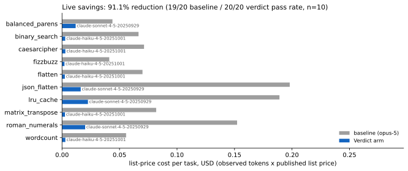

# Benchmarks and measurements

This index lists every benchmark in this repository and what it does and does not show.

**No cost saving is claimed yet.** The only live cost run found no routing saving (see below).
A savings claim returns only with paired live evidence on held-out tasks.

| Benchmark | Kind | Result | Details |
|---|---|---|---|
| Live cost check, 2026-09-28 | live, real models | **no saving**: both arms used the same model | [`docs/proof/live-savings-2026-09-28/`](../proof/live-savings-2026-09-28/) |
| Context packing (#336) | live, one paired run (n=1) | `conclusion=lift` on one check | [context-lift.md](context-lift.md) |
| Paired savings bench | offline fixture | refuses to claim savings (`claims_allowed=false`) | [paired-savings.md](paired-savings.md) |
| Routing demo | deterministic mock | no provider spend | [routing-demo.md](routing-demo.md) |

## Live cost check (negative result)

**No routing saving measured yet.** A live run on real models found that Verdict's
offline router chose the same model as the baseline for every task, so the two arms
cost the same apart from run-to-run token variance.

Setup: fifteen coding tasks (10 standalone + 5 repo-context), each run twice per arm,
graded by executable unit tests. Both arms sent the same prompt.

- **Baseline arm**: every task sent to `cc/claude-opus-5`.
- **Verdict arm**: model chosen by `Gate.route(allow_offline=True)`, the CLI catalog path.
  This path has no live `EligibilityGate`, provider health or quota input, so this run
  does **not** measure the live admission/eligibility router. It chose `cc/claude-opus-5`
  for all 15 tasks.

| Measure (list price x observed tokens) | Overall | Standalone (n=10) | Repo-context (n=5) |
|---|---|---|---|
| Baseline list-price cost | $0.7668 | $0.6225 | $0.1443 |
| Verdict list-price cost | $0.8386 | $0.6756 | $0.1631 |
| (task, repeat) pairs compared | 26 | 20 | 6 |

Same model and same prompt in both arms: the cost difference is token variance between
runs, not a routing effect. Pass rates were 26/30 (baseline arm) and 30/30 (Verdict arm);
with identical model and input this is also run-to-run variance, not a Verdict advantage.
Costs are compared only over (task, repeat) pairs where both arms passed; the four
excluded pairs are cooldown_sentinel r1/r2 and ladder_stages r1/r2 (baseline failed).

Costs are **not billed amounts**: [published list prices](https://www.anthropic.com/pricing)
(fetched at run time; page SHA-256 in the proof dir) applied to observed token usage on
subscription capacity (no invoice). Small n (15 tasks x 2 repeats).



<sub>Data: [`docs/proof/live-savings-2026-09-28/report.json`](../proof/live-savings-2026-09-28/report.json).
Observed token usage x published list prices; subscription capacity, no invoice.
Method: [`scripts/live_savings_bench.py`](../../scripts/live_savings_bench.py);
run with `VERDICT_LIVE_SMOKE=1` (opt-in, spends real capacity).</sub>

Observed data, not a fixture. It is kept to show a negative result, not a saving.
That run used an earlier version of the script; the method below replaces it.

## Paired usage bench (method; one run, no claim supported)

**No saving is claimed yet.** This section describes how a live run is measured.
It holds no result and no number.

One paired usage run on 2026-11-19 did not support a claim: the Verdict arm completed fewer
tasks than the baseline, so the bench refused it. Its evidence is not published yet.

[`scripts/live_savings_bench.py`](../../scripts/live_savings_bench.py) runs every task in
`benchmarks/fixtures/live_savings/tasks.json` in two arms:

- **Baseline**: the task prompt only, no context pack, sent to the frontier model you name
  with `--baseline-model`. The flag is required and has no default.
- **Verdict**: the route Verdict picks on the live eligibility ladder, built the same way
  `verdict serve` builds it (the live routing service with the `EligibilityGate` attached).
  This arm sends Verdict's context pack plus the same prompt. It may use only free and
  subscription capacity and never an opaque `auto/*` or `combo/*` route. If Verdict denies
  the task, or picks a route outside that capacity, the task counts as a Verdict miss.
  The bench never falls back to the baseline model.

A task is accepted only when its own test file passes. The bench never edits tasks, tests
or acceptance criteria; it hashes them before and after the run, and a change blocks any claim.

For every call the bench records the model that served it and its request id (from the
`X-OmniRoute-*` response headers), the provider-reported input, cached-input and output
tokens, and the route's capacity class. Routing confirm probes and retries count against
the arm that caused them.

The report gives, per arm and per task group, the accepted-work rate and the tokens split by
capacity class. Tokens are the headline measure. The report refuses a savings claim when:

- the Verdict arm accepted fewer tasks than the baseline;
- no pair is comparable. A pair is comparable only when both arms passed and different
  models served them. A pair where one model served both arms shows no saving, and a failed
  pair never counts as one;
- the Verdict arm did not use fewer uncached tokens on the comparable pairs;
- the tasks or tests changed during the run, or the run hit its time limit.

Cached-input tokens are reported apart from the model-choice comparison, so a cache hit
never reads as a routing saving. Dollars appear only when you pass `--list-prices`, as one
secondary line labelled "list-price equivalent, not an invoice".

Run it (opt-in; it spends real capacity, and `--out-dir` must be outside the repository):

```bash
VERDICT_LIVE_SMOKE=1 OMNIROUTE_BASE_URL=http://127.0.0.1:20128 \
  uv run python scripts/live_savings_bench.py \
  --baseline-model <frontier route> --out-dir /tmp/<run-dir> --repeats 1 --max-wall-seconds 3600
```
